# Verify Report

2026-11-18 14:00 · 20 passed, 0 failed

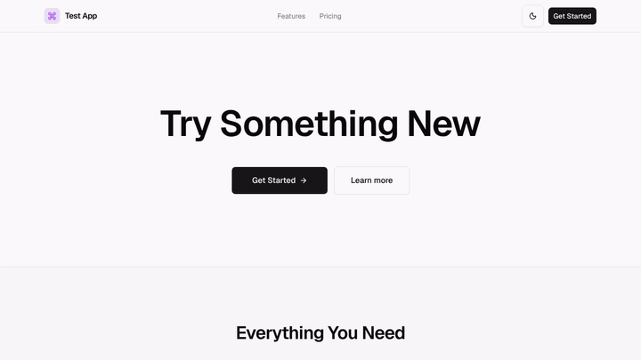

[Video of the run](run.webm)

## Checks

### ✅ page /

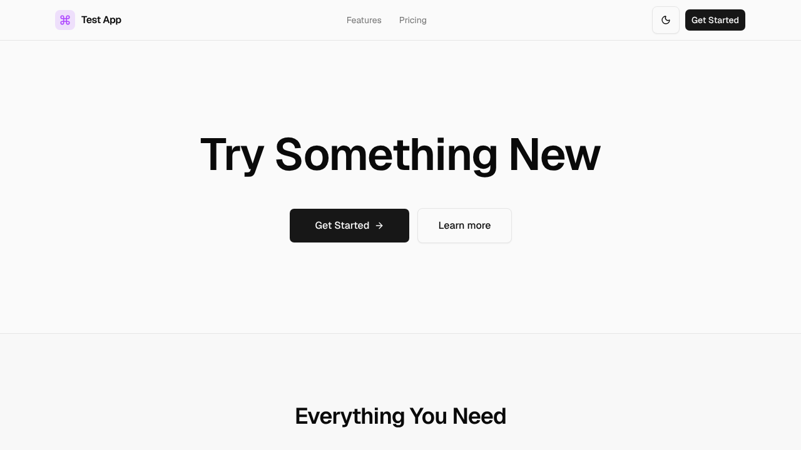

### ✅ page /app/home

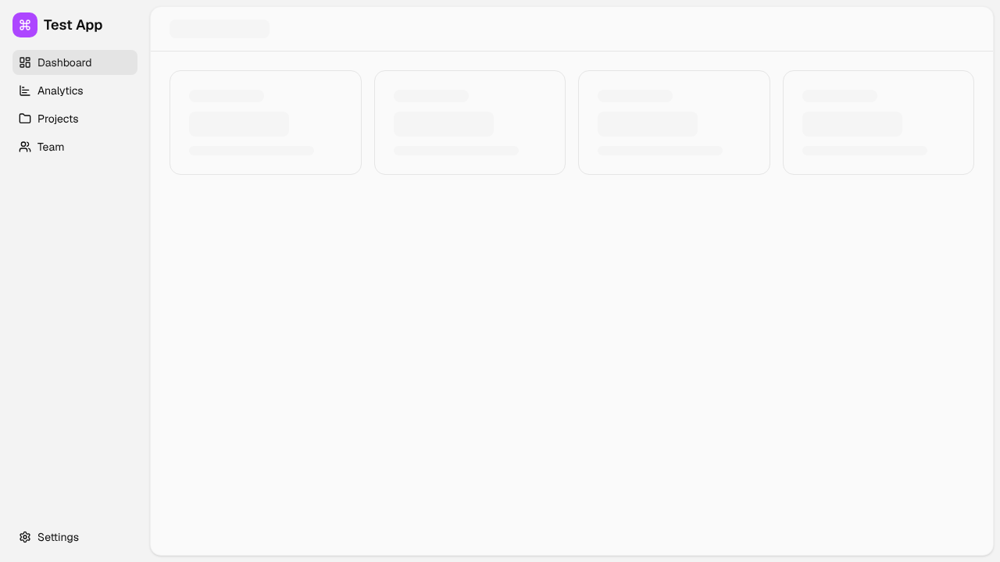

### ✅ page /app/analytics

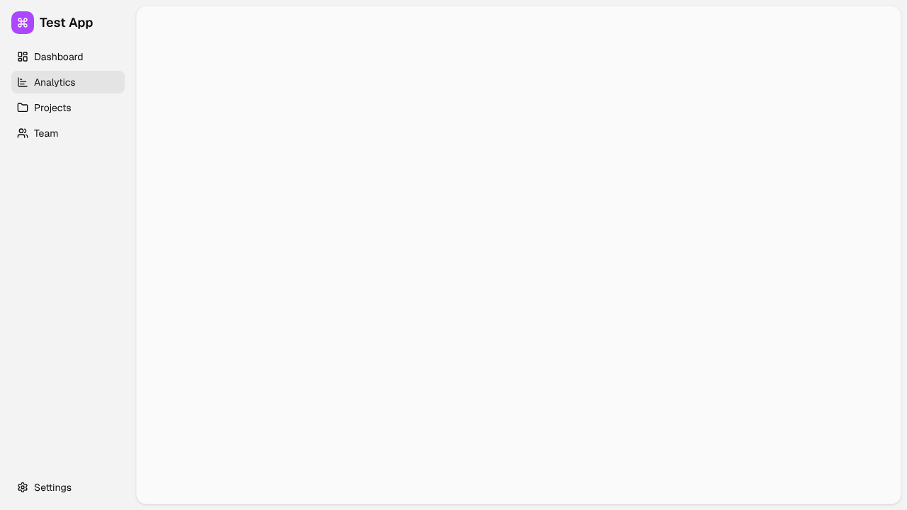

### ✅ page /app/projects

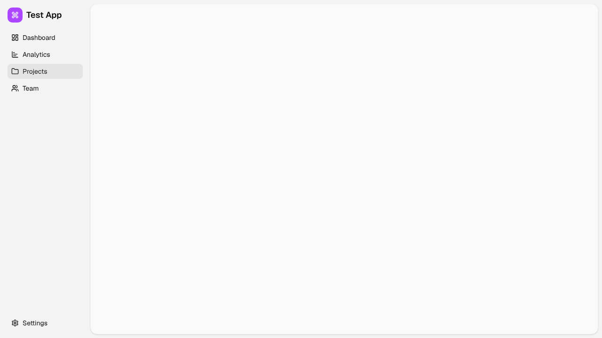

### ✅ page /app/team

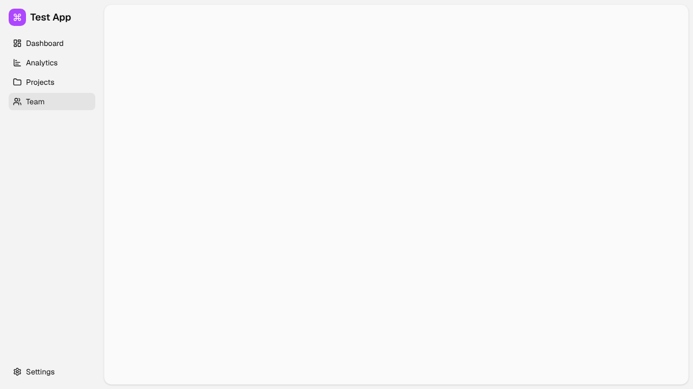

### ✅ page /app/settings

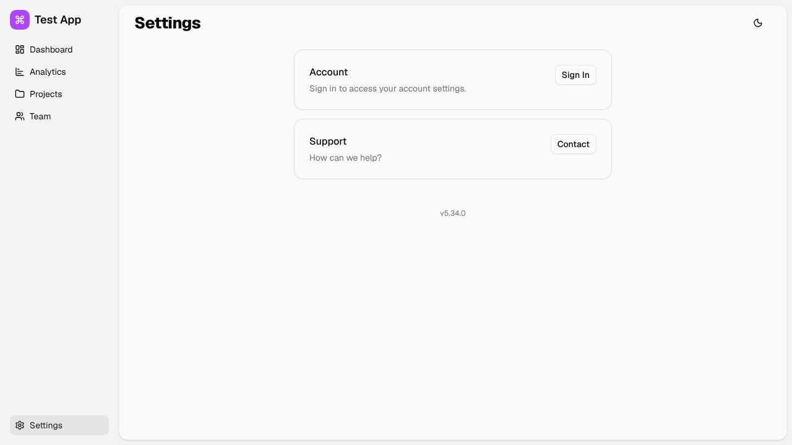

### ✅ page /terms

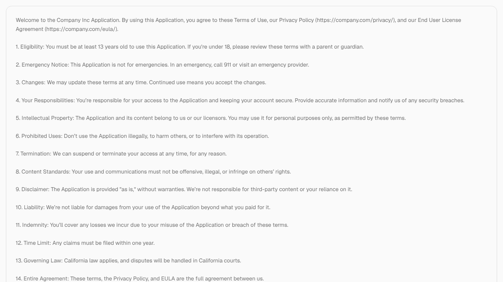

### ✅ page /this-route-does-not-exist

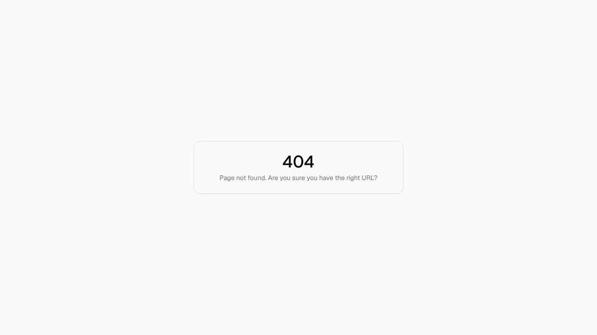

### ✅ feature: Landing page

### ✅ feature: Guest access

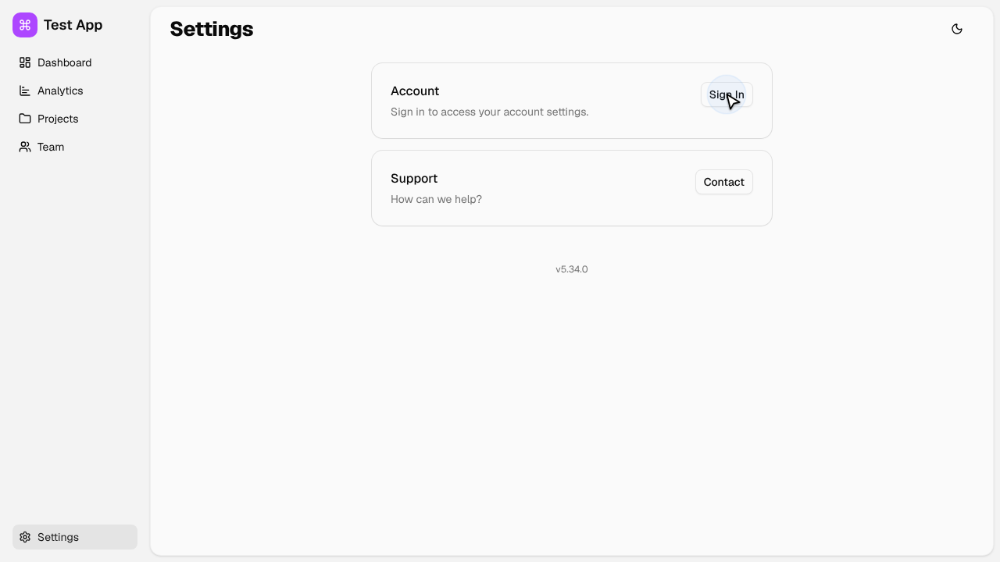

### ✅ feature: Sign up

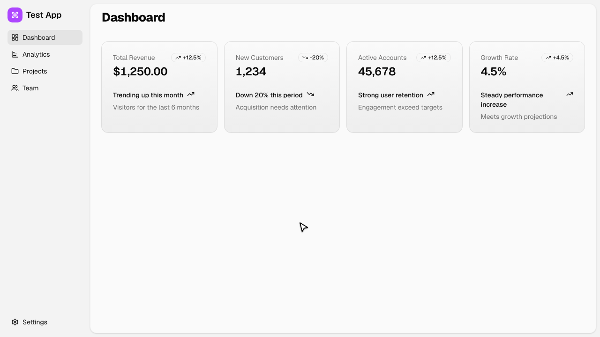

### ✅ feature: Dashboard

### ✅ feature: Empty state

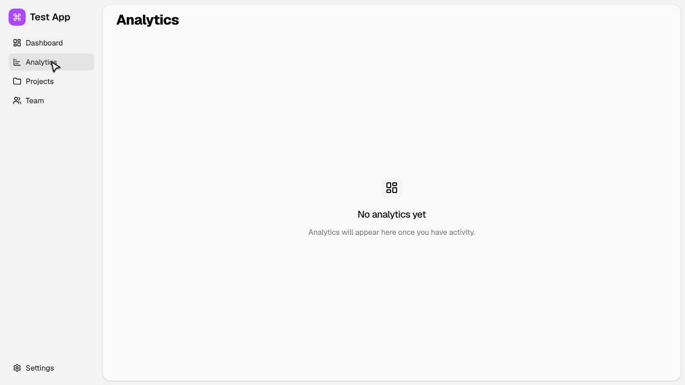

### ✅ feature: Command menu

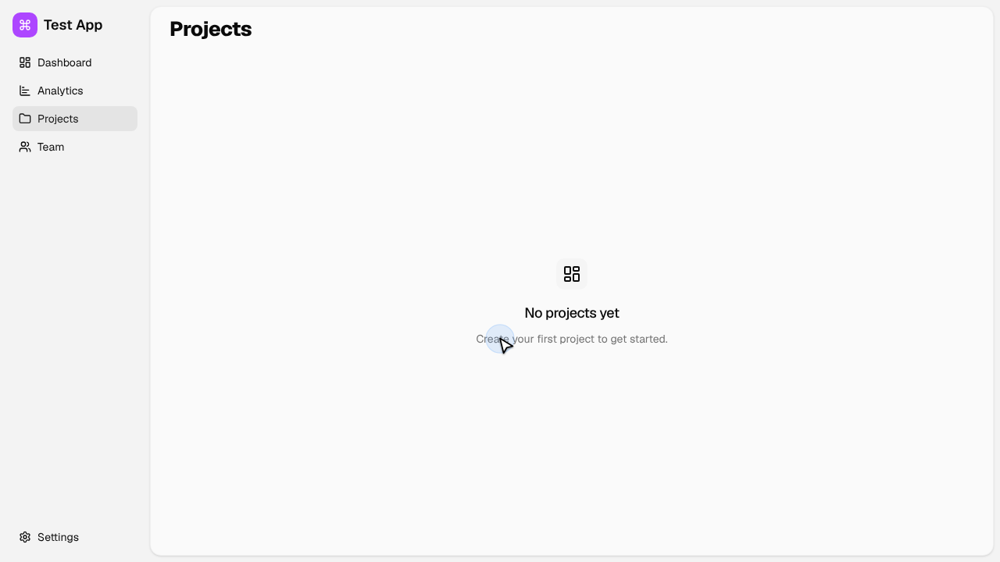

### ✅ feature: Settings

### ✅ feature: Sign out

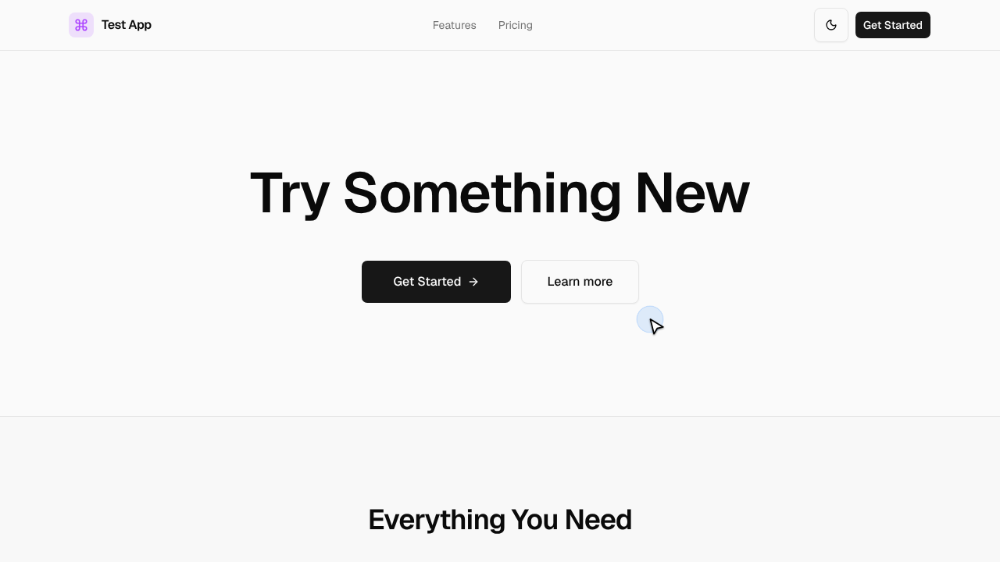

### ✅ feature: Sign up after an account

### ✅ feature: Sign in

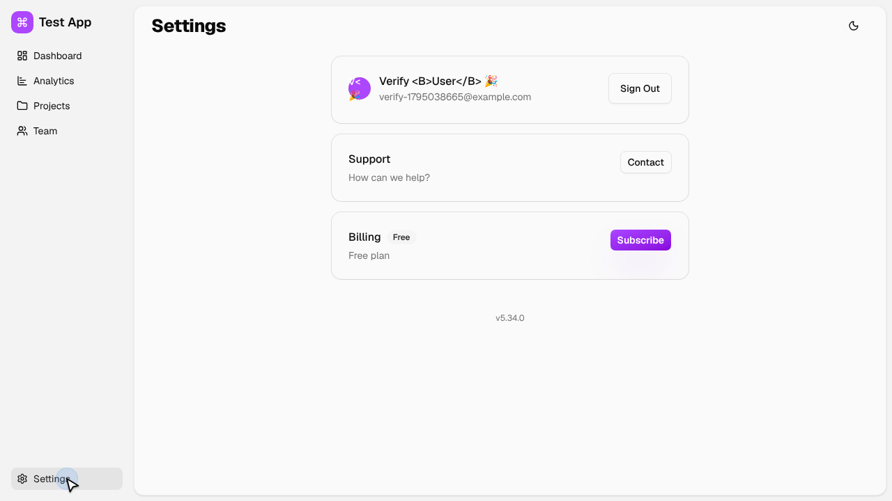

### ✅ feature: Terms

### ✅ property: 30 random clicks and typing kept every rule (seed 746196844)

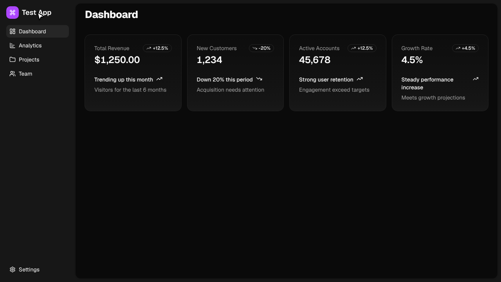

## State chart

1. guest on landing
   1. click Get Started → guest in app
   1. open sign up → guest signing up
   1. open sign in → guest signing in
   1. open terms → guest reads terms
1. guest reads terms
   1. go back → guest on landing
1. guest in app
   1. open settings → guest asked to sign in
   1. go home → guest on landing
1. guest asked to sign in
   1. open sign in → guest signing in
   1. go back → guest in app
1. guest signing up
   1. sign up → user in app
   1. close → guest on landing
1. guest signing in
   1. sign in → user in app
   1. wrong password → guest sees sign-in error
   1. close → guest on landing
1. guest sees sign-in error
   1. sign in → user in app
   1. close → guest on landing
1. user in app
   1. open command menu → user in command menu
   1. open settings → user sees account
1. user in command menu
   1. pick a page → user in app
   1. close → user in app
1. user sees account
   1. go back → user in app
   1. sign out → user confirming sign out
1. user confirming sign out
   1. cancel → user sees account
   1. confirm → guest on landing
1. Rules
   1. never: guest sees account
   1. only by sign up|sign in: user in app
   1. only by sign up|sign in: user sees account

## Feature map

1. Landing page
   1. page: /
   1. flow: landing
1. Guest access
   1. page: /
   1. flow: guest_settings
1. Sign up
   1. page: /signup
   1. flow: sign_up
1. Dashboard
   1. page: /app/home
   1. flow: dashboard
1. Empty state
   1. page: /app/home
   1. flow: analytics
1. Command menu
   1. page: /app/home
   1. flow: command_menu
1. Settings
   1. page: /app/home
   1. flow: settings
1. Sign out
   1. page: /app/settings
   1. flow: sign_out
1. Sign up after an account
   1. page: /signup
   1. flow: sign_up_again
1. Sign in
   1. page: /signin
   1. flow: sign_in
1. Terms
   1. page: /terms
   1. flow: terms

